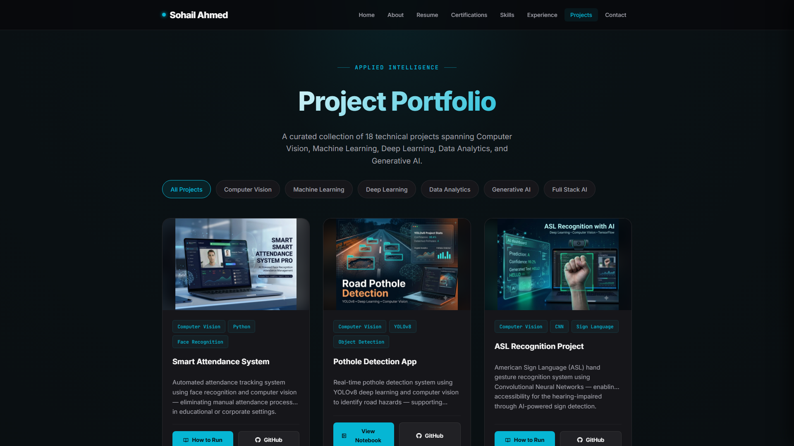
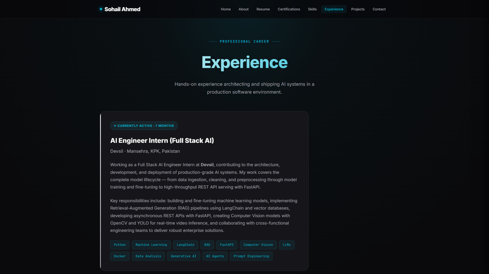
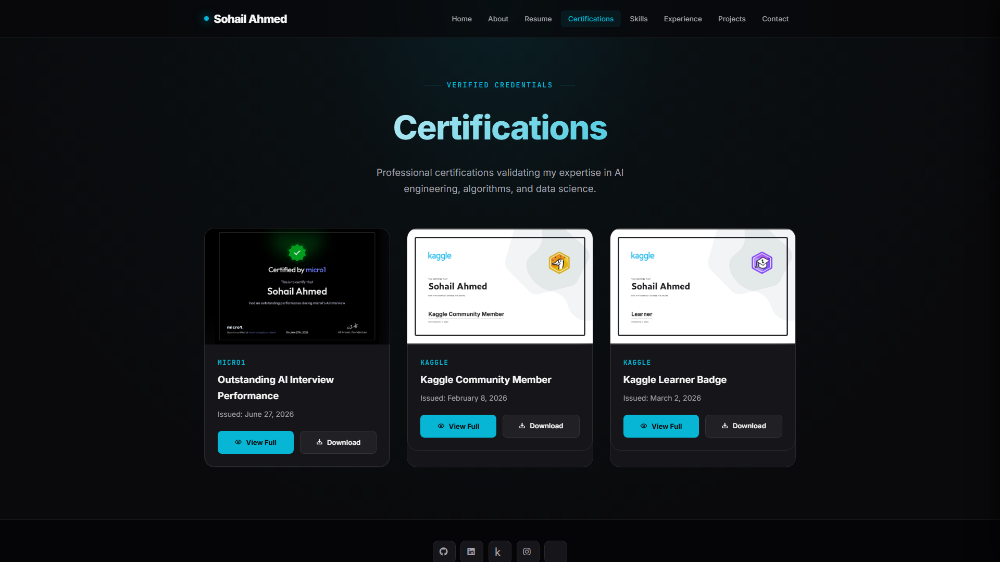
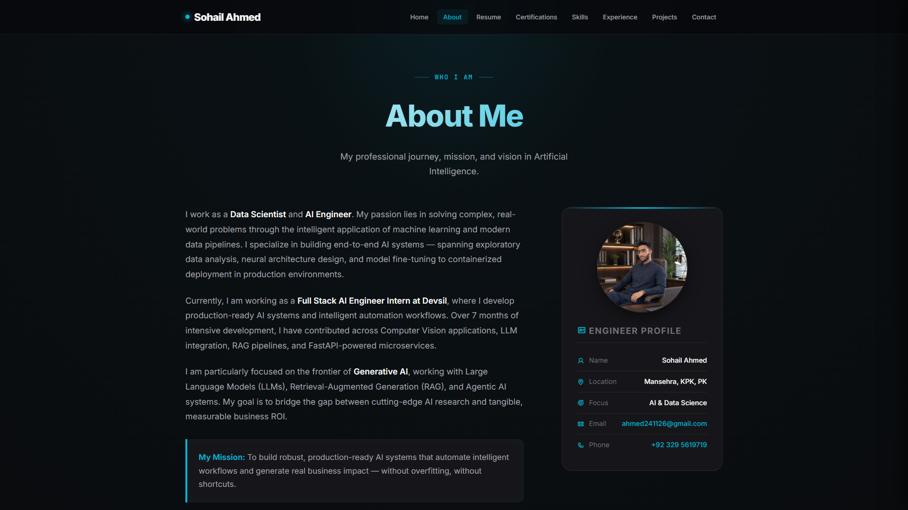
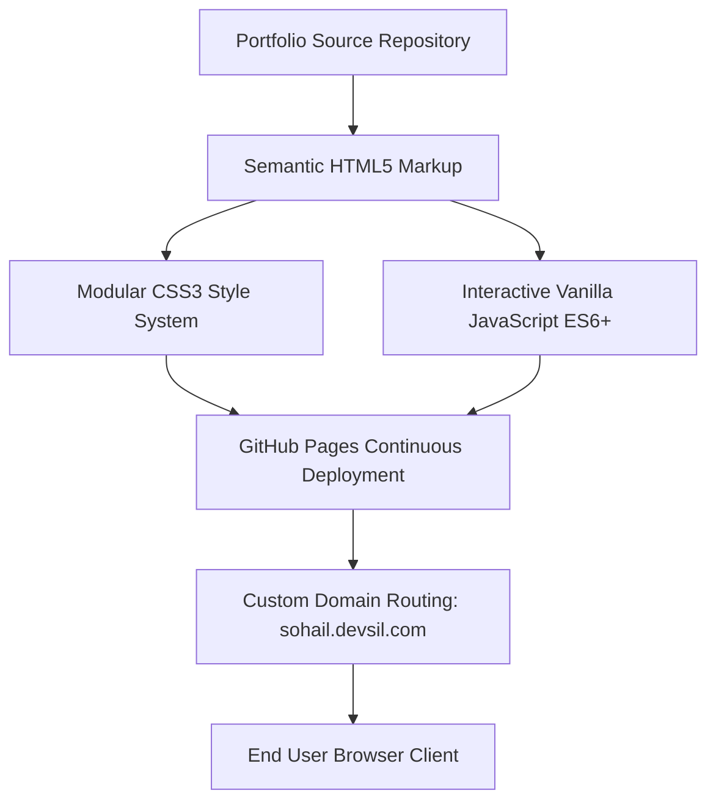

<div align="center">

<h1>Sohail Ahmed - Developer Portfolio Website</h1>


<p><strong>Source Code and Assets for Personal Developer Portfolio Hosted Live on sohail.devsil.com</strong></p>

<p>
  <a href="https://skillicons.dev"></a>
</p>

<p>
  <a href="#overview">Overview</a> &bull;
  <a href="#system-architecture">Architecture</a> &bull;
  <a href="#visual-showcase-gallery">Visual Gallery</a> &bull;
  <a href="#core-capabilities">Capabilities</a> &bull;
  <a href="#installation--setup">Installation</a> &bull;
  <a href="#author--contact-information">Author</a>
</p>

</div>

---
## Overview

This repository contains the source code, stylesheets, and visual assets for the personal software engineering portfolio of **Sohail Ahmed**, accessible globally at [sohail.devsil.com](https://sohail.devsil.com). The site presents full-stack AI applications, machine learning projects with interactive Jupyter notebook viewers, client recommendations, and professional credentials.

---

## Visual Showcase Gallery

<table width="100%" align="center">
  <tr>
    <td width="50%" align="center"><b>Landing Hero & Technical Summary</b><br><sub>Hero section with professional introduction and navigation.</sub></td>
    <td width="50%" align="center"><b>Project Portfolio Grid</b><br><sub>Interactive cards linking to GitHub repos and nbviewer notebooks.</sub></td>
  </tr>
  <tr>
    <td align="center"></td>
    <td align="center"></td>
  </tr>
  <tr>
    <td width="50%" align="center"><b>Professional Experience Timeline</b><br><sub>Career history, accomplishments, and engineering roles.</sub></td>
    <td width="50%" align="center"><b>Technical Skills & Stack Matrix</b><br><sub>Categorized breakdown of AI, CV, backend, and database tools.</sub></td>
  </tr>
  <tr>
    <td align="center"></td>
    <td align="center"></td>
  </tr>
  <tr>
    <td width="50%" align="center"><b>Certifications & Credentials</b><br><sub>Verified badges from Kaggle, Micro1, and technical organizations.</sub></td>
    <td width="50%" align="center"><b>Direct Contact & Inquiry Form</b><br><sub>Contact options for recruiters, clients, and technical teams.</sub></td>
  </tr>
  <tr>
    <td align="center"></td>
    <td align="center"></td>
  </tr>
  <tr>
    <td colspan="2" align="center"><b>About Me & Personal Mission</b><br><sub>Detailed narrative on engineering philosophy and problem solving.</sub></td>
  </tr>
  <tr>
    <td colspan="2" align="center"></td>
  </tr>
</table>

---

## System Architecture



---

## Technology Stack

| Layer | Technologies |
| :--- | :--- |
| Markup & Styling | HTML5, CSS3, Modern CSS Grid & Flexbox |
| Interactivity | Vanilla JavaScript (ES6+) |
| Deployment & Hosting | GitHub Pages, Cloudflare DNS |
| Live Domain | sohail.devsil.com |

---

## Local Development

```bash
# Clone the repository
git clone https://github.com/sohailahmed-bsrh/myportfolio.git
cd myportfolio

# Start a local static file server
python -m http.server 8000
```
Open `http://localhost:8000` in your web browser.
---

## Author & Contact Information

<table width="100%" align="center">
  <tr>
    <td align="center" style="padding: 20px;">
      <h3>Sohail Ahmed</h3>
      <p><strong>Full-Stack Artificial Intelligence & Computer Vision Engineer</strong></p>
      <p>
        <a href="https://sohail.devsil.com"></a>
        <a href="https://github.com/sohailahmed-bsrh"></a>
        <a href="https://linkedin.com/in/sohail-ahmed-dev"></a>
        <a href="mailto:sohail.bsrh@gmail.com"></a>
      </p>
      <p><em>Available for technical roles in Artificial Intelligence, Computer Vision, and Full-Stack Engineering.</em></p>
      <hr style="border: 0; height: 1px; background: #30363d; margin: 15px 0;">
      <small>Repository: <code>sohailahmed-bsrh/myportfolio</code> &bull; Distributed under the MIT License.</small>
    </td>
  </tr>
</table>
