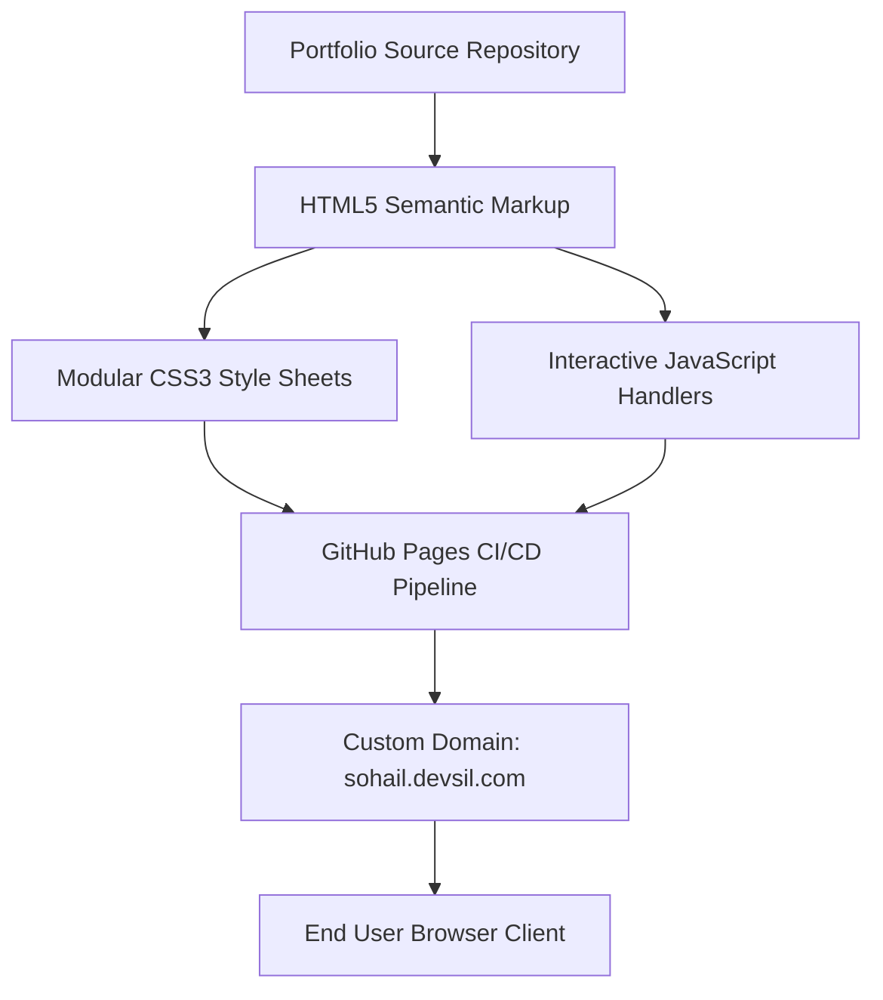

# Developer Portfolio

## Overview
This repository hosts the source code and assets for the personal software engineering and artificial intelligence portfolio website, accessible globally at [sohail.devsil.com](https://sohail.devsil.com).

## System Architecture



## Core Features
- **Interactive Project Showcase**: Dynamic project grid linking directly to verified GitHub repositories and interactive Jupyter notebook viewers (`nbviewer.org`).
- **Responsive Architecture**: Mobile-first design system ensuring consistency across mobile, tablet, and desktop viewports.
- **Asset Optimization**: High-performance modern asset formatting (WebP/SVG) minimizing page load latencies.
- **Automated Deployment**: GitHub Pages continuous deployment integrated with custom CNAME domain verification.

## Repository Structure
```
myportfolio/
|-- about.html
|-- index.html
|-- projects.html
|-- CNAME
|-- assets/
|   |-- css/
|   |   +-- style.css
|   |-- cv/
|   |   +-- Sohail_Ahmed_CV.pdf
|   +-- images/
|       |-- certificates/
|       +-- clients/
+-- README.md
```

## Technology Stack
| Area | Technologies |
| :--- | :--- |
| Markup & Styling | HTML5, CSS3, Modern Flexbox/Grid |
| Interactivity | Vanilla JavaScript (ES6+) |
| Hosting & CDN | GitHub Pages, Cloudflare DNS |
| Live Domain | sohail.devsil.com |

## Local Development
```bash
# Clone repository
git clone https://github.com/sohailahmed-bsrh/myportfolio.git
cd myportfolio

# Start a local static file server
python -m http.server 8000
```
Open `http://localhost:8000` in your web browser.

## License
Distributed under the MIT License.
