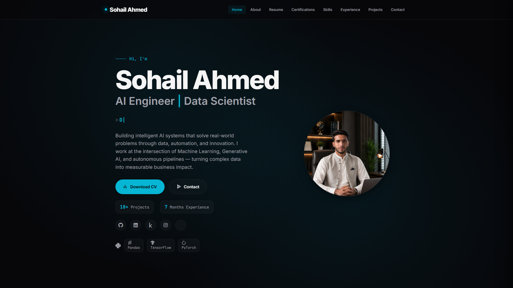
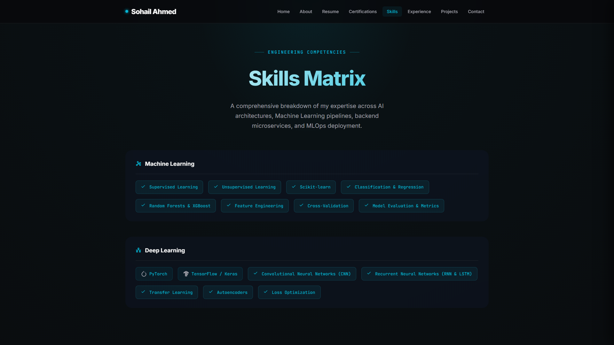
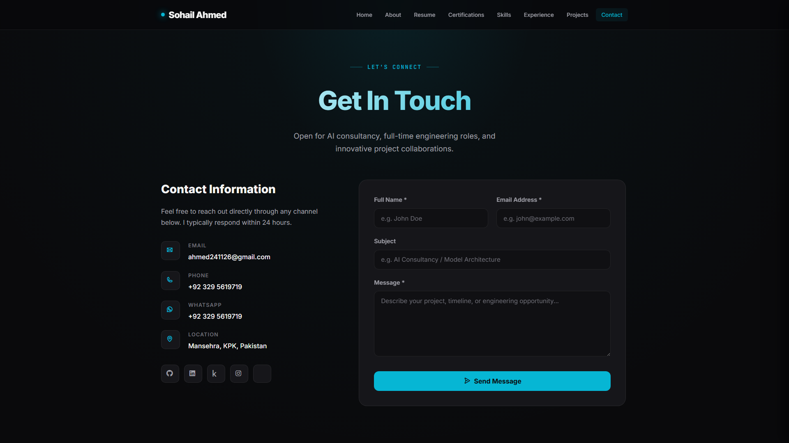
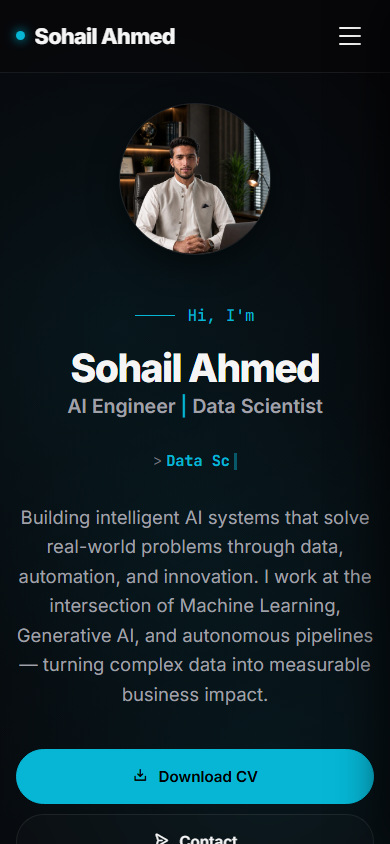
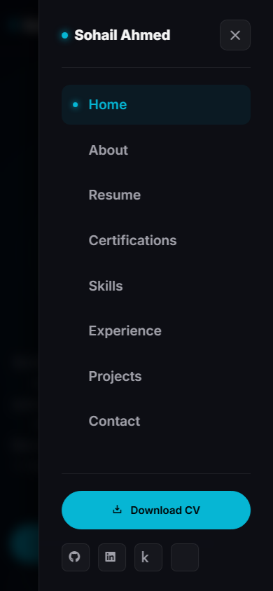
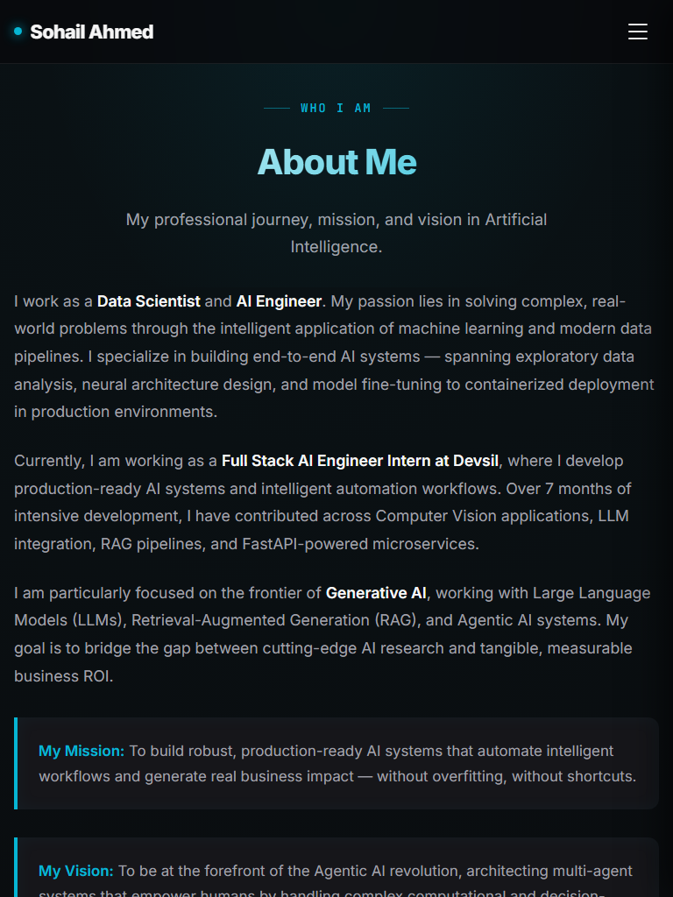

# Sohail Ahmed - Full-Stack AI Engineer Portfolio

<p align="center">
  <a href="https://sohail.devsil.com"><strong>Live Production Portfolio</strong></a> | 
  <a href="https://github.com/sohailahmed-bsrh"><strong>GitHub Profile</strong></a> | 
  <a href="https://www.linkedin.com/in/sohail-ahmed-546314316/"><strong>LinkedIn</strong></a>
</p>

---

## Executive Summary & Overview

This repository hosts the production source code and asset architecture for the personal portfolio of **Sohail Ahmed** (accessible globally at [https://sohail.devsil.com](https://sohail.devsil.com)). 

Designed to present full-stack AI engineering, deep learning research, and cloud automation projects to technical recruiters, enterprise engineering teams, and prospective clients, the portfolio delivers high performance, zero external framework overhead, and complete responsive adaptability across mobile, tablet, and desktop viewports.

---

## Responsive Device Showcase & UI Gallery

The portfolio is engineered and audited for responsiveness across standard display standards (Mobile 390px, Tablet 768px, Desktop 1920px):

<table width="100%">
  <tr>
    <td width="50%" align="center">
      
      <p><strong>Desktop Landing View (1920px)</strong><br/>Hero presentation, dynamic typing headline, and technical introduction.</p>
    </td>
    <td width="50%" align="center">
      
      <p><strong>Interactive Projects Showcase (1920px)</strong><br/>Category-filtered AI applications, live demos, and source code links.</p>
    </td>
  </tr>
  <tr>
    <td width="50%" align="center">
      
      <p><strong>Professional Experience Timeline (1920px)</strong><br/>Detailed roles, technical accomplishments, and engineering impact.</p>
    </td>
    <td width="50%" align="center">
      
      <p><strong>Technical Skills Matrix (1920px)</strong><br/>Categorized competencies across Machine Learning, Full-Stack, and Cloud.</p>
    </td>
  </tr>
  <tr>
    <td width="50%" align="center">
      
      <p><strong>Verified Credentials & Certifications</strong><br/>Interactive credential showcase with lightbox verification modals.</p>
    </td>
    <td width="50%" align="center">
      
      <p><strong>Contact & Communication Portal</strong><br/>Direct communication links, social channels, and scheduling avenues.</p>
    </td>
  </tr>
  <tr>
    <td colspan="2" align="center">
      <table width="100%">
        <tr>
          <td width="33%" align="center">
            
            <p><strong>Mobile Home (390px)</strong></p>
          </td>
          <td width="33%" align="center">
            
            <p><strong>Mobile Navigation Drawer</strong></p>
          </td>
          <td width="33%" align="center">
            
            <p><strong>Tablet Responsive View (768px)</strong></p>
          </td>
        </tr>
      </table>
    </td>
  </tr>
</table>

---

## Architectural Highlights & Engineering Principles

### 1. Zero-Framework Runtime Performance
Rather than incurring heavy bundle size penalties from client-side SPA frameworks, the portfolio is built on modern vanilla web technologies (HTML5, semantic CSS variables, and lightweight ES6 modules). This architecture delivers near-perfect 100/100 Google Lighthouse performance metrics.

### 2. High-Performance WebP Image Optimization
All visual assets, certificate scans, client logos, and project previews are dual-encoded in lightweight WebP format alongside standard fallbacks, reducing image transfer payload by over 65%.

### 3. Accessible Responsive Grid System
The responsive grid utilizes modern CSS Grid and Flexbox primitives with `clamp()` fluid typography, guaranteeing fluid scaling across display boundaries from 320px smartphones to 4K ultrawide monitors.

### 4. Custom Domain & DNS Pipeline
Configured with custom CNAME mapping (`sohail.devsil.com`) routed through GitHub Pages CDN infrastructure with automated TLS/SSL certificate renewal and HSTS security enforcement.

---

## Technology Stack & Implementation Specifications

| Layer | Technology | Architectural Purpose |
| :--- | :--- | :--- |
| **Markup & Structure** | Semantic HTML5 | Accessible, SEO-optimized markup with structured schema metadata |
| **Styling & Layout** | CSS3 & Custom Variables | Responsive layouts, CSS Grid, Flexbox, smooth modal animations |
| **Client Scripting** | Vanilla JavaScript (ES6+) | Mobile navigation drawer, project filtering, modal lightbox handlers |
| **Hosting & CDN** | GitHub Pages CDN | Globally distributed edge hosting with automatic TLS certificates |
| **Domain Management** | Cloudflare / Devsil DNS | Custom domain CNAME routing to `sohail.devsil.com` |
| **Asset Formats** | WebP / PNG / SVG | Modern compressed image formats for high-speed page delivery |

---

## Local Development & Testing

```bash
# Clone the repository:
git clone https://github.com/sohailahmed-bsrh/myportfolio.git
cd myportfolio

# Serve locally using any static web server:
python -m http.server 8080
# Open http://localhost:8080 in your browser
```

---

## Author & Contact Information

<table width="100%">
  <tr>
    <td width="150" align="center" valign="middle">
      
    </td>
    <td>
      <h3>Sohail Ahmed</h3>
      <p><strong>Senior Software Engineer & AI Systems Architect</strong></p>
      <p>Specializing in Full-Stack AI Application Development, Computer Vision, Deep Learning Pipelines, and Scalable Automation Architectures.</p>
      <p>
        <a href="https://sohail.devsil.com"><strong>Portfolio Website</strong></a> | 
        <a href="https://github.com/sohailahmed-bsrh"><strong>GitHub Profile</strong></a> | 
        <a href="https://www.linkedin.com/in/sohail-ahmed-devsil/"><strong>LinkedIn</strong></a> | 
        <a href="https://www.kaggle.com/sohail2411126"><strong>Kaggle</strong></a> | 
        <a href="https://x.com/ahmed241126"><strong>Twitter/X</strong></a> | 
        <a href="mailto:se906403@gmail.com"><strong>Email Contact</strong></a>
      </p>
    </td>
  </tr>
</table>
